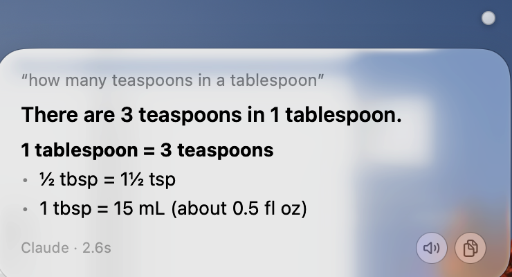
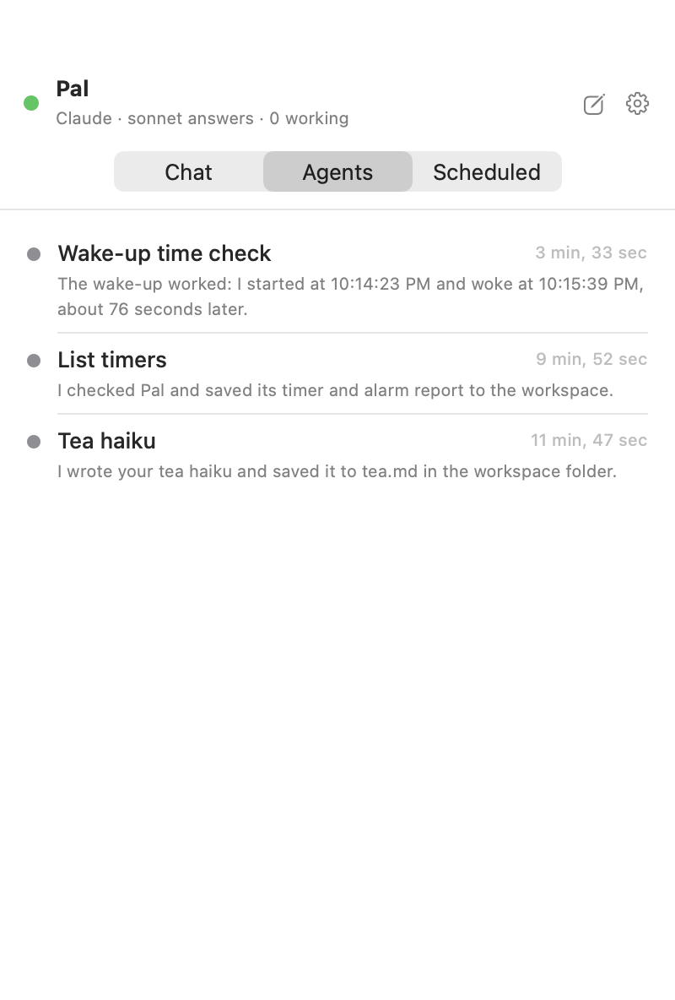
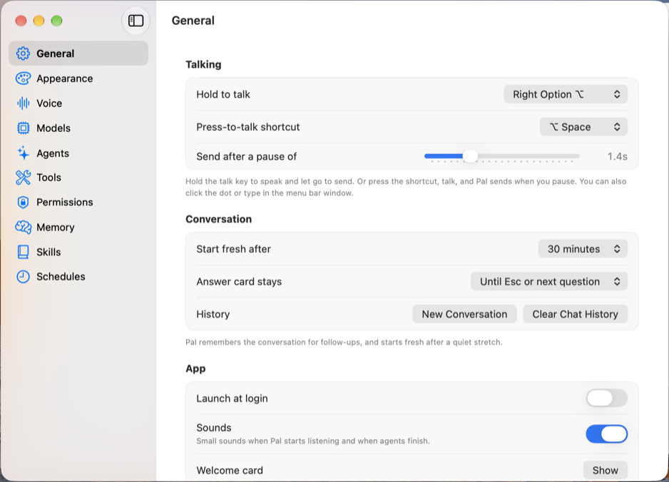

# Pal

A small dot in the corner of your Mac that you talk to. It answers quick questions on a glass card, and hands bigger jobs to background agents that use your Mac and report back.

<p>
  
  
</p>

## Install

Download the latest **Pal-<version>.dmg** from [Releases](https://github.com/morajabi/pal/releases) and drag Pal to Applications. It updates itself. It needs macOS 26 or later, plus one of:
- [Claude Code](https://claude.com/claude-code), signed in
- [Codex](https://developers.openai.com/codex/cli) with ChatGPT
- a Claude API key

## Use

- **Hold Right Option** and talk, or press **⌥ Space**, or click the dot.
- **Esc** hides the card.
- Ask quick things ("how many grams in a cup of flour"), or hand off work ("watch my Claude Code sessions for two hours and nudge them if they get stuck").
- Right-click the dot for agents, settings and updates.



## Develop

```bash
brew install xcodegen
./scripts/run.sh          # builds and launches "Pal Dev"
```

- `docs/ARCHITECTURE.md` explains how it fits together.
- `docs/RELEASING.md` covers shipping (`scripts/release.sh <version>`).
- For a stable dev signature, put your team in `Config/Local.xcconfig`:
  ```
  CODE_SIGN_STYLE = Automatic
  CODE_SIGN_IDENTITY = Apple Development
  DEVELOPMENT_TEAM = <your team id>
  ```
